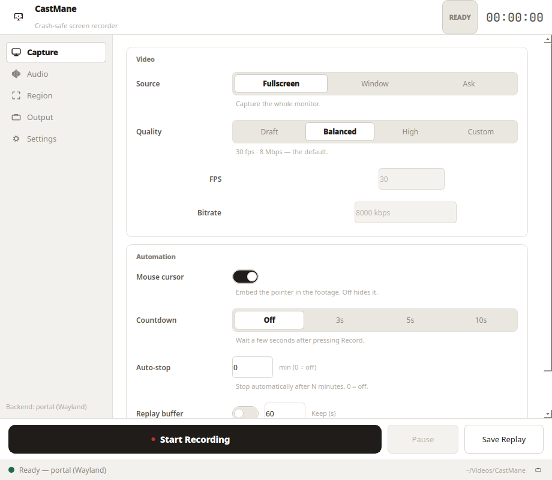
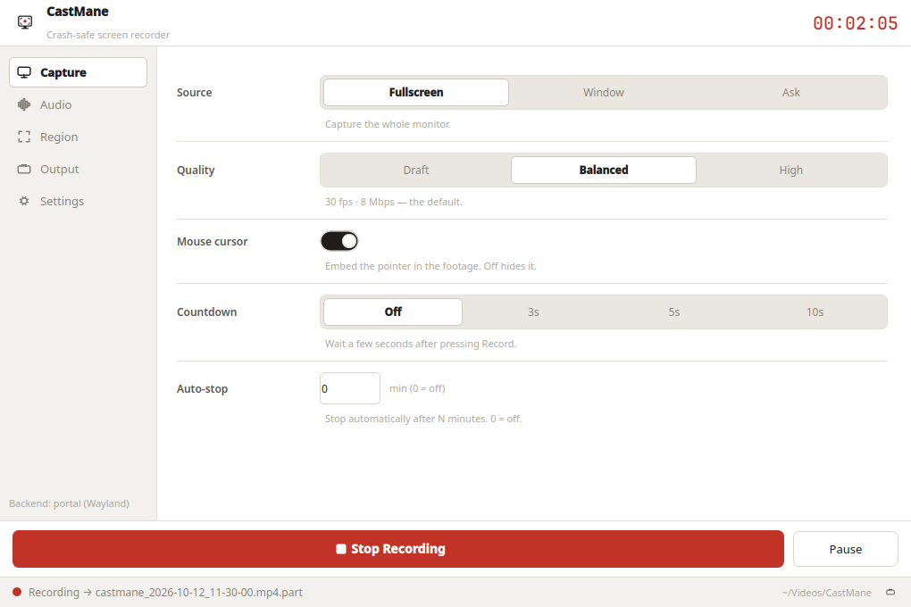
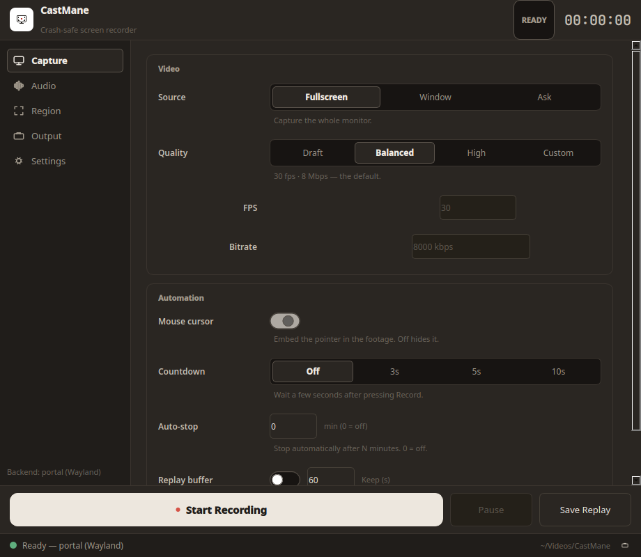

<p align="center">
  
</p>

<h1 align="center">CastMane</h1>

<p align="center">
  <strong>Crash-safe screen recorder for Linux (Wayland-first).</strong><br />
  If the app crashes mid-recording, your footage survives.
</p>

<p align="center">
  <a href="https://github.com/akamusti/CastMane/releases"></a>
  <a href="LICENSE"></a>
  
  
</p>

<p align="center">
  <a href="README.tr.md">🇹🇷 Türkçe için tıklayın</a>
</p>

Many recorders write the `.mp4` index only on clean shutdown — if the app
crashes mid-recording, the whole file is often lost. CastMane is built
around a single principle: **a crash must never cost you the footage.**

> Verified: a recording killed with `kill -9` remains fully playable
> (`h264`, `ffprobe`-checked). See [Crash-safety](#crash-safety).

## Quick start

Download the AppImage from the
[Releases page](https://github.com/akamusti/CastMane/releases), then:

```bash
chmod +x CastMane-*.AppImage
./CastMane-*.AppImage
```

That's it — no Python, venv, or pip setup. The AppImage bundles Python, Qt,
and all PyPI dependencies.

## Screenshots



| Recording | Dark theme | Audio settings |
|---|---|---|
|  |  |  |

## Features

| Area | Capability |
|---|---|
| Full-screen | Native Wayland capture via `xdg-desktop-portal` ScreenCast + GStreamer, lossless MP4 remux on stop |
| X11 fallback | `ffmpeg` (`x11grab`) backend, selected automatically |
| Crash-safe | Fragmented container, `.part` staging, atomic rename, graceful shutdown, encoder watchdog |
| Minimal UI | Record / Stop / Pause, elapsed timer, status line |
| Pause & quality | Freeze the encoder mid-take; Draft / Balanced / High presets |
| Source choice | Full-screen, single window, or ask every time |
| Audio | Optional mic or system-sound capture (AAC) with software gain |
| Output | Timestamped `castmane_YYYY-MM-DD_HH-MM-SS.mp4` files in `~/Videos/CastMane` |

## Requirements

| Component | Wayland backend | X11 backend |
|---|---|---|
| OS | Linux, Python >= 3.10 | Linux, Python >= 3.10 |
| Video pipeline | `gst-launch-1.0` with `pipewiresrc`, `openh264enc`, `matroskamux` | `ffmpeg` with `x11grab` |
| System service | `xdg-desktop-portal` with a ScreenCast backend (KDE/GNOME provide one) | — |
| Audio (optional) | Pulse/PipeWire source (`pactl list short sources`) | Pulse source |

Install the host tools (the AppImage bundles everything else):

```bash
# Fedora / KDE (tested on Fedora 44, KDE Plasma, Wayland)
sudo dnf install ffmpeg gstreamer1 gstreamer1-plugins-base gstreamer1-plugins-good gstreamer1-plugin-openh264

# Ubuntu / Debian
sudo apt install ffmpeg gstreamer1.0-tools gstreamer1.0-plugins-base gstreamer1.0-plugins-good gstreamer1.0-plugins-ugly
```

Missing something? The app shows a friendly popup telling you exactly what
to install.

## Installation

### Option 1 — AppImage (recommended)

```bash
chmod +x CastMane-*.AppImage
./CastMane-*.AppImage
```

### Option 2 — Build the AppImage yourself

```bash
./packaging/build-appimage.sh
./dist/CastMane-*.AppImage
```

### Option 3 — From source (developers)

```bash
python3 -m venv .venv && source .venv/bin/activate
pip install -e .
python3 -m castmane
```

No system Python packages or compiler toolchain required: the Wayland backend
drives the portal over D-Bus (`dbus-next`) and runs GStreamer as a subprocess,
so `PyGObject` is not needed.

## Usage

1. **Start the app.** The status line shows the active backend, e.g.
   `Ready [portal (Wayland)]`.
2. **Pick a source:** Full-screen, Window, or Ask / Select region.
   On Wayland the system dialog lists monitors or windows; on X11, *Ask*
   opens a drag-to-select frame.
3. **Press Record.** On Wayland the system screen-share dialog appears —
   pick the monitor or window and confirm (you have 180 seconds).
4. **Press Stop.** The finished file lands in `~/Videos/CastMane`.

## Language & theme

The interface is English with the light theme by default. Open the
**Settings** tab to switch language (**EN** / **TR**) or theme (**Light** /
**Dark** / **Ocean** / **Midnight** / **Forest** / **Dracula** / **Nord**) —
both apply instantly and are remembered on next launch.
In code: `AppConfig(language="tr", theme="dark")`.

**Recovering an interrupted recording:** on the next launch the app
offers to **Restore** leftover `*.mkv.part` (Wayland) or `*.mp4.part`
(X11) files next to your finished videos — or **Delete** / **Later**.
Restored files play as-is (on Wayland, optionally remux to MP4 yourself:
`ffmpeg -i file.mkv.part -c copy file.mp4`).

## Crash-safety

| Layer | Mechanism |
|---|---|
| Container | MKV staging (`matroskamux` tolerates missing timestamps), MP4 via lossless `ffmpeg -c copy` remux on clean stop |
| File handling | Write to `X.mp4.part`, `os.replace()` to `X.mp4` only on clean stop |
| Shutdown | `SIGINT` -> wait -> `SIGTERM` -> `SIGKILL` escalation |
| Monitoring | Encoder watchdog reports early exits with the last log lines |

<details>
<summary>Reproduce the proof yourself</summary>

Kill a live MKV recording, then remux:

```bash
gst-launch-1.0 videotestsrc is-live=true ! videoconvert ! openh264enc \
  ! h264parse ! matroskamux ! filesink location=proof.mkv.part &
sleep 4; kill -9 $!
ffprobe -v error -show_entries stream=codec_name proof.mkv.part
ffmpeg -y -v error -i proof.mkv.part -c copy proof.mp4
ffprobe -v error -show_entries stream=codec_name,duration proof.mp4
```

</details>

## Configuration

<details>
<summary><strong>Pause & quality presets</strong></summary>

Press **Pause** mid-recording to freeze the encoder (`SIGSTOP`); the timer
stops and the paused stretch is left out of the footage. **Resume** continues
into the same file. Stopping while paused resumes first, so the trailer is
always written cleanly.

```python
from castmane.config import AppConfig
cfg = AppConfig()
cfg.apply_quality_preset("high")  # "draft" | "balanced" | "high"
```

| Preset | fps | Bitrate |
|---|---|---|
| Draft | 24 | 4 Mbps |
| Balanced | 30 | 8 Mbps |
| High | 60 | 16 Mbps |

</details>

<details>
<summary><strong>Capture source</strong></summary>

```python
from castmane.config import AppConfig
cfg = AppConfig(capture_mode="window")  # "fullscreen" | "window" | "ask"
# X11 fixed region (0 = full screen):
# cfg = AppConfig(region_x=100, region_y=200, region_w=1280, region_h=720)
# X11 single window (id from `xwininfo`):
# cfg = AppConfig(capture_mode="window", window_id=123456)
```

On Wayland, `window` / `ask` switch the portal dialog from monitors to
windows (or both). On X11, `ask` lets you drag the region with the mouse
(`ffmpeg -select_region`), while `region_*` / `window_id` give scriptable
control. Crash-safety is unchanged: region and window recordings still go
through the `.part` + atomic-rename pipeline.

</details>

<details>
<summary><strong>Audio</strong></summary>

Tick **Record audio** in the window and pick the source — **Mic**,
**Desktop** (system sound), or **Both** (mixed into one track) — or in code:

```python
from castmane.config import AppConfig
cfg = AppConfig(audio_enabled=True)  # default mic
# system sound instead:
# cfg = AppConfig(audio_enabled=True, audio_mode="desktop")
# mic + system sound mixed:
# cfg = AppConfig(audio_enabled=True, audio_mode="both")
# explicit monitor device (skips auto-detection):
# cfg = AppConfig(audio_enabled=True, audio_mode="desktop",
#     audio_desktop_source="alsa_output.pci-0000_00_1f.3.analog-stereo.monitor")
```

List devices with `pactl list short sources`. "Desktop" auto-detects the
first `.monitor` source. Audio is encoded as AAC
(`avenc_aac` on Wayland, `aac` on X11) into the same crash-safe file, so a
`kill -9` recording and its MP4 remux both keep the audio track.

> **Quiet system sound?** Monitor sources have no mic-style input boost, so
> system audio can sound much fainter than mic recordings. Raise the gain in
> the window (**%**) or in code (`AppConfig(audio_gain=2.0)` ~ +6 dB,
> `3.0` ~ +9.5 dB). Stay at or below `5.0` to avoid clipping.

</details>

## Architecture

```
src/castmane/
|-- app.py               # Qt main window (Record/Stop, timer, status)
|__ config.py            # Output dir, fps, bitrate, fragment settings
+-- recorder.py          # Crash-safe core: FfmpegX11Recorder + finalize_part()
+-- backends/__init__.py # create_backend(): portal on Wayland, ffmpeg on X11
`-- backends/portal.py   # PortalRecorder: ScreenCast D-Bus + gst-launch pipe
                           (MKV record, MP4 remux on stop)
```

Portal signatures are discovered from the broker at runtime
(`session_handle` type, `Start` argument order), so the client keeps working
across `xdg-desktop-portal` versions.

## Roadmap

- [x] Full-screen recording (Wayland + X11)
- [x] Crash-safe output pipeline
- [x] Audio capture (mic / desktop / both, selectable in the UI)
- [x] Window / region selection
- [x] Pause / resume, configurable quality presets
- [x] One-file AppImage distribution

## Contributing

Issues and pull requests are welcome. Please keep recordings-related test
evidence (`ffprobe` output, steps to reproduce) in bug reports about lost or
corrupt footage — crash-safety is the point of this app.

## License

GPL-3.0-or-later. See [LICENSE](LICENSE).
