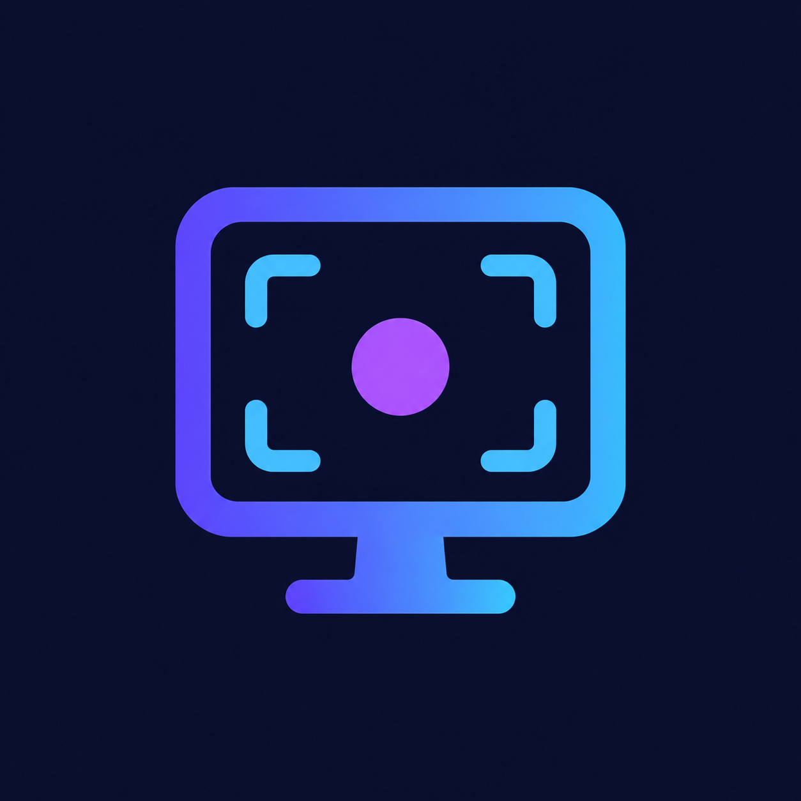

<p align="center">
  
</p>

<h1 align="center">CastMane</h1>

<p align="center">
  <strong>Linux için crash-safe ekran kaydedici (Wayland öncelikli).</strong><br />
  Uygulama kaydın ortasında çökse bile görüntünüz kaybolmaz.
</p>

<p align="center">
  <a href="https://github.com/akamusti/CastMane/releases"></a>
  <a href="LICENSE"></a>
  
  
</p>

<p align="center">
  <a href="README.md">🇬🇧 Click for English</a>
</p>

Çoğu kaydedici `.mp4` dizinini (`moov` atomu) yalnızca düzgün kapatmada
yazar — uygulama kaydın ortasında çökerse tüm dosya çoğu zaman kaybolur.
CastMane tek bir ilke üzerine kurulu: **çöküş, görüntüye mal olmamalı.**

> Doğrulandı: `kill -9` ile öldürülen bir kayıt tamamen oynatılabilir kalıyor
> (`h264`, `ffprobe` ile denetlendi). Bkz. [Crash-güvenliği](#crash-güvenliği).

## Hızlı başlangıç

[Sürümler sayfasından](https://github.com/akamusti/CastMane/releases)
AppImage'i indirin, sonra:

```bash
chmod +x CastMane-*.AppImage
./CastMane-*.AppImage
```

Hepsi bu — Python, venv ya da pip kurulumu gerekmez. AppImage Python, Qt
ve tüm PyPI bağımlılıklarını içinde getirir.

## Özellikler

| Alan | Yetenek |
|---|---|
| Tam ekran | `xdg-desktop-portal` ScreenCast + GStreamer ile yerel Wayland yakalama, duruşta kayıpsız MP4 remux |
| X11 yedeği | `ffmpeg` (`x11grab`) backend'i, otomatik seçilir |
| Crash-safe | Parçalı kapsayıcı, `.part` staging, atomik rename, nazik kapatma, encoder izcisi |
| Sade arayüz | Kayıt / Durdur / Duraklat, geçen süre, durum satırı |
| Duraklatma ve kalite | Çekimin ortasında encoder'ı dondurun; Taslak / Dengeli / Yüksek ön ayarları |
| Kaynak seçimi | Tam ekran, tek pencere ya da her seferinde sor |
| Ses | Yazılımsal kazançlı, isteğe bağlı mikrofon veya sistem sesi kaydı (AAC) |
| Çıktı | `~/Videos/CastMane` altında zaman damgalı `castmane_YYYY-MM-DD_HH-MM-SS.mp4` dosyaları |

## Gereksinimler

| Bileşen | Wayland backend'i | X11 backend'i |
|---|---|---|
| İşletim sistemi | Linux, Python >= 3.10 | Linux, Python >= 3.10 |
| Video hattı | `pipewiresrc`, `openh264enc`, `matroskamux` içeren `gst-launch-1.0` | `x11grab` içeren `ffmpeg` |
| Sistem servisi | ScreenCast destekli `xdg-desktop-portal` (KDE/GNOME sağlar) | — |
| Ses (isteğe bağlı) | Pulse/PipeWire kaynağı (`pactl list short sources`) | Pulse kaynağı |

Host araçlarını kurun (geri kalan her şeyi AppImage içinde getirir):

```bash
# Fedora / KDE (Fedora 44, KDE Plasma, Wayland'de test edildi)
sudo dnf install ffmpeg gstreamer1 gstreamer1-plugins-base gstreamer1-plugins-good gstreamer1-plugin-openh264

# Ubuntu / Debian
sudo apt install ffmpeg gstreamer1.0-tools gstreamer1.0-plugins-base gstreamer1.0-plugins-good gstreamer1.0-plugins-ugly
```

Bir şey mi eksik? Uygulama neyi kurmanız gerektiğini söyleyen anlaşılır
bir pencere gösterir.

## Kurulum

### Seçenek 1 — AppImage (önerilen)

```bash
chmod +x CastMane-*.AppImage
./CastMane-*.AppImage
```

### Seçenek 2 — AppImage'i kendiniz derleyin

```bash
./packaging/build-appimage.sh
./dist/CastMane-*.AppImage
```

### Seçenek 3 — Kaynaktan (geliştiriciler)

```bash
python3 -m venv .venv && source .venv/bin/activate
pip install -e .
python3 -m castmane
```

Sistem Python paketi ya da derleyici gerekmez: Wayland backend'i portalı
D-Bus üzerinden (`dbus-next`) sürer ve GStreamer'ı alt proses olarak
çalıştırır, bu yüzden `PyGObject` gerekmez.

## Kullanım

1. **Uygulamayı başlatın.** Durum satırı aktif backend'i gösterir, örn.
   `Hazır [portal (Wayland)]`.
2. **Kaynak seçin:** Tam Ekran, Pencere ya da Sor / Bölge Seç.
   Wayland'da sistem diyafonu monitörleri veya pencereleri listeler; X11'de
   *Sor* sürükle-seç çerçevesi açar.
3. **Kayda basın.** Wayland'da sistemin ekran paylaşım diyafonu açılır —
   monitörü ya da pencereyi seçip onaylayın (180 saniye süreniz var).
4. **Durdur'a basın.** Bitmiş dosya `~/Videos/CastMane` altındadır.

## Dil ve tema

Arayüz varsayılan olarak İngilizce ve açık temalıdır. Dil (**EN** / **TR**)
ya da tema (**Açık** / **Koyu**) değiştirmek için **Ayarlar** sekmesini açın —
ikisi de anında uygulanır ve bir sonraki açılışta hatırlanır.
Kod ile: `AppConfig(language="tr", theme="dark")`.

**Yarıda kesilen kaydı kurtarma:** aynı klasördeki `*.mkv.part` (Wayland)
ya da `*.mp4.part` (X11) dosyasına bakın — aynen oynatılır. Yeniden
adlandırmanız yeterli (Wayland'da isterseniz MP4'e kendiniz çevirin:
`ffmpeg -i dosya.mkv.part -c copy dosya.mp4`).

## Crash-güvenliği

| Katman | Mekanizma |
|---|---|
| Kapsayıcı | MKV staging (`matroskamux` eksik damgaları tolere eder), düzgün duruşta kayıpsız `ffmpeg -c copy` ile MP4 |
| Dosya taşıma | `X.mp4.part` dosyasına yaz, düzgün duruşta `os.replace()` ile `X.mp4` yap |
| Kapatma | `SIGINT` -> bekle -> `SIGTERM` -> `SIGKILL` kademesi |
| İzleme | Encoder izcisi erken ölümleri son log satırlarıyla raporlar |

<details>
<summary>Kanıtı kendiniz tekrarlayın</summary>

Canlı bir MKV kaydını öldürüp remux edin:

```bash
gst-launch-1.0 videotestsrc is-live=true ! videoconvert ! openh264enc \
  ! h264parse ! matroskamux ! filesink location=kanit.mkv.part &
sleep 4; kill -9 $!
ffprobe -v error -show_entries stream=codec_name kanit.mkv.part
ffmpeg -y -v error -i kanit.mkv.part -c copy kanit.mp4
ffprobe -v error -show_entries stream=codec_name,duration kanit.mp4
```

</details>

## Yapılandırma

<details>
<summary><strong>Duraklatma ve kalite ön ayarları</strong></summary>

Kayıt sırasında **Duraklat**'a basarak encoder'ı dondurun (`SIGSTOP`); süre
durur ve duraklatılan aralık görüntüye girmez. **Sürdür** aynı dosyaya devam
eder. Duraklatılmışken durdurma yapılırsa önce sürdürme yapılır, böylece
trailer her zaman temiz yazılır.

```python
from castmane.config import AppConfig
cfg = AppConfig()
cfg.apply_quality_preset("high")  # "draft" | "balanced" | "high"
```

| Ön ayar | fps | Bit hızı |
|---|---|---|
| Taslak | 24 | 4 Mbps |
| Dengeli | 30 | 8 Mbps |
| Yüksek | 60 | 16 Mbps |

</details>

<details>
<summary><strong>Yakalama kaynağı</strong></summary>

```python
from castmane.config import AppConfig
cfg = AppConfig(capture_mode="window")  # "fullscreen" | "window" | "ask"
# X11 sabit bölge (0 = tam ekran):
# cfg = AppConfig(region_x=100, region_y=200, region_w=1280, region_h=720)
# X11 tek pencere (kimlik `xwininfo` çıktısından):
# cfg = AppConfig(capture_mode="window", window_id=123456)
```

Wayland'da `window` / `ask` portal diyafonunu monitörden pencereye çevirir
(ya da ikisini birden sorar). X11'de `ask` fareyle bölge seçtirir
(`ffmpeg -select_region`), `region_*` / `window_id` ise betiklenebilir kontrol
verir. Crash-güvenliği değişmez: pencere ve bölge kayıtları da `.part` +
atomik rename hattından geçer.

</details>

<details>
<summary><strong>Ses</strong></summary>

Pencerede **Sesi kaydet** kutusunu işaretleyip kaynağı seçin — **Mikrofon**,
**Masaüstü** (sistem sesi) ya da **İkisi** (tek parçada birleşir) — ya da
kodla verin:

```python
from castmane.config import AppConfig
cfg = AppConfig(audio_enabled=True)  # varsayılan mikrofon
# sistem sesi için:
# cfg = AppConfig(audio_enabled=True, audio_mode="desktop")
# mikrofon + sistem sesi birlikte:
# cfg = AppConfig(audio_enabled=True, audio_mode="both")
# açık monitor cihazı (otomatik bulmayı atlar):
# cfg = AppConfig(audio_enabled=True, audio_mode="desktop",
#     audio_desktop_source="alsa_output.pci-0000_00_1f.3.analog-stereo.monitor")
```

Cihazları `pactl list short sources` ile listeleyin. "Masaüstü" ilk
`.monitor` kaynağını otomatik bulur. Ses, aynı crash-safe
dosyaya AAC olarak yazılır (Wayland'da `avenc_aac`, X11'de `aac`); `kill -9`
ile ölen kayıt da MP4 remux da ses parçasını korur.

> **Sistem sesi cılız mı geliyor?** Monitor kaynaklarında mikrofonlardaki gibi
> giriş yükseltmesi yoktur, o yüzden sistem sesi mikrofon kaydına göre çok
> daha kısık duyulur. Penceredeki **Ses kazancı (%)** ayarını yükseltin ya da
> kodla verin (`AppConfig(audio_gain=2.0)` ≈ +6 dB, `3.0` ≈ +9,5 dB).
> Kırpılma olmaması için `5.0` üstüne çıkmayın.

</details>

## Mimari

```
src/castmane/
|-- app.py               # Qt ana pencere (Kayıt/Durdur, süre, durum)
|__ config.py            # Çıktı dizini, fps, bit hızı, parça ayarları
+-- recorder.py          # Crash-safe çekirdek: FfmpegX11Recorder + finalize_part()
+-- backends/__init__.py # create_backend(): Wayland'da portal, X11'de ffmpeg
`-- backends/portal.py   # PortalRecorder: ScreenCast D-Bus + gst-launch hattı
                           (MKV kayıt, duruşta MP4 remux)
```

Portal imzaları çalışma anında broker'dan okunur (`session_handle` tipi,
`Start` parametre sırası), böylece istemci farklı `xdg-desktop-portal`
sürümlerinde çalışmaya devam eder.

## Yol haritası

- [x] Tam ekran kaydı (Wayland + X11)
- [x] Crash-safe çıktı hattı
- [x] Ses kaydı (mikrofon / masaüstü / ikisi, arayüzden seçilir)
- [x] Pencere / bölge seçimi
- [x] Duraklat / devam et, yapılandırılabilir kalite ön ayarları
- [x] Tek dosyalık AppImage dağıtımı

## Katkıda bulunma

Issue ve pull request'lere açığız. Kayıp ya da bozuk görüntüyle ilgili hata
bildirimlerine lütfen kayıtla ilgili test kanıtını ekleyin (`ffprobe`
çıktısı, tekrarlama adımları) — crash-güvenliği bu uygulamanın varlık nedeni.

## Lisans

GPL-3.0-or-later. Bkz. [LICENSE](LICENSE).
