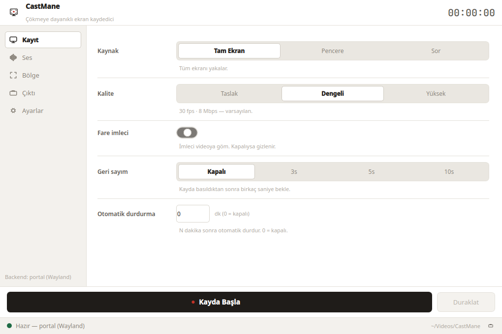
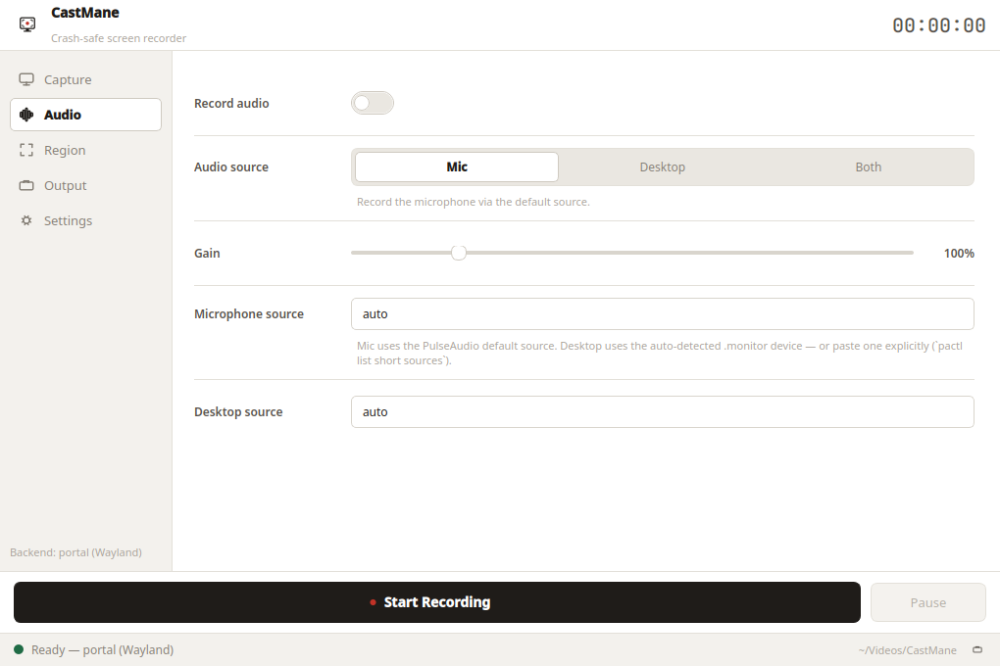

import { Card, CardGrid } from '@astrojs/starlight/components';

## Neden CastMane?

Çoğu kaydedici `.mp4` dizinini (`moov` atomu) yalnızca düzgün kapatmada
yazar — uygulama kaydın ortasında çökerse tüm dosya çoğu zaman kaybolur.
CastMane tek bir ilke üzerine kurulu: **çöküş, görüntüye mal olmamalı.**

> Doğrulandı: `kill -9` ile öldürülen bir kayıt tamamen oynatılabilir
> kalıyor (`h264`, `ffprobe` ile denetlendi). Bkz.
> [crash-güvenliği rehberi](guides/crash-safety/).



## Uygulama çalışırken


Koyu tema ve ses ayarları:

| Koyu tema | Ses ayarları |
|---|---|
|  |  |

<CardGrid stagger>
  <Card title="Tasarım gereği crash-safe" icon="shield">
    Parçalı kapsayıcı, `.part` staging, atomik rename, kademeli nazik kapatma
    ve encoder izcisi.
  </Card>
  <Card title="Wayland öncelikli, X11 yedekli" icon="desktop">
    Wayland'de `xdg-desktop-portal` ScreenCast + GStreamer ile yerel yakalama,
    X11'de otomatik `ffmpeg` (`x11grab`) yedeği.
  </Card>
  <Card title="Sade arayüz" icon="star">
    Kayıt / Durdur / Duraklat, geçen süre, durum satırı. Taslak / Dengeli /
    Yüksek kalite ön ayarları.
  </Card>
  <Card title="Tek dosyalık kurulum" icon="download">
    Tek bir AppImage Python, Qt ve tüm bağımlılıkları içerir. venv, pip ya da
    derleyici gerekmez.
  </Card>
</CardGrid>

## Hızlı başlangıç

```bash
chmod +x CastMane-*.AppImage
./CastMane-*.AppImage
```

Hepsi bu. Ayrıntılar için [Kurulum](getting-started/installation/).
